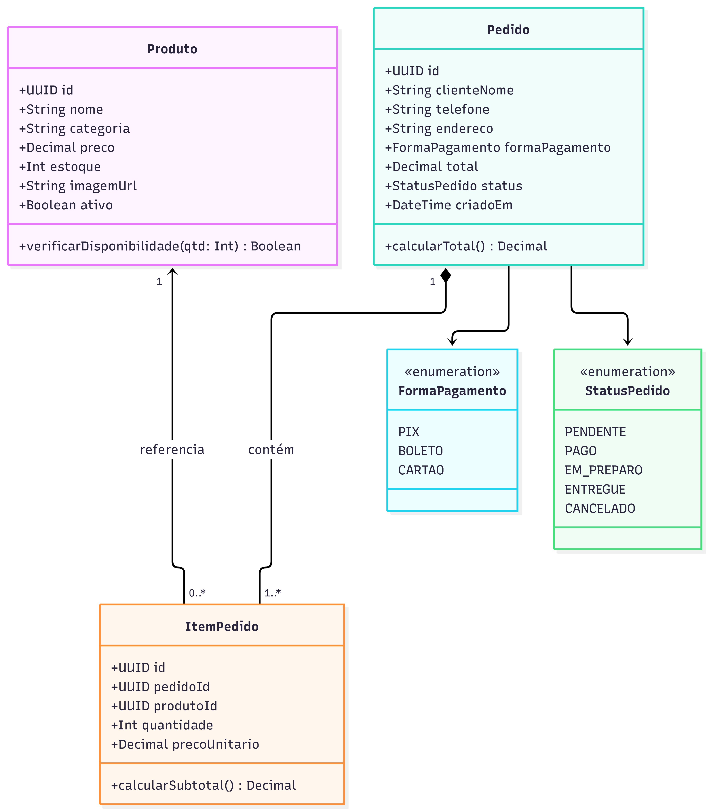
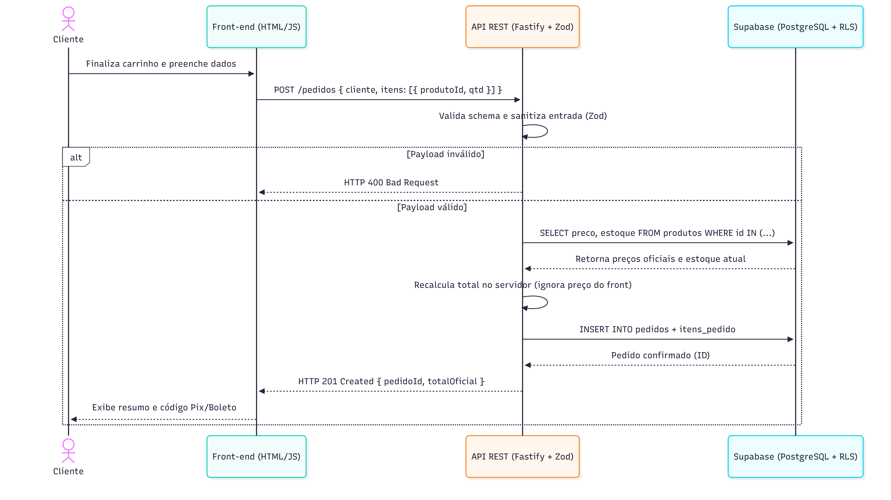

<div align="center">

# 🍰 Doce Encanto — E-commerce Full-Stack

**Sistema de pedidos e vitrine digital para confeitaria e salgados artesanais, projetado com arquitetura Full-Stack e foco em DevSecOps.**


</div>

---

## 🛠️ Arquitetura & Tecnologias

| Camada | Tecnologias | Papel no Projeto |
| :--- | :--- | :--- |
| **Front-end** | HTML5, CSS3, JavaScript Vanilla | Vitrine, carrinho persistente (`localStorage`) e checkout com Pix EMV CRC16 |
| **Back-end** | Node.js, TypeScript, Fastify, **Zod** | API REST tipada com validação estrita de entrada e regras de negócio |
| **Banco & Segurança** | Supabase (**PostgreSQL** + **RLS**) | Persistência relacional e controle de acesso em nível de linha |
| **Gestão Ágil** | GitHub Projects (Kanban) | Fluxo contínuo (`Backlog` → `Todo` → `In Progress` → `Testing` → `Done`) |

---

## 🔒 Segurança & Boas Práticas (DevSecOps)

| Vetor de Risco | Mitigação Implementada | Camada |
| :--- | :--- | :--- |
| **Cross-Site Scripting (XSS)** | Sanitização na renderização do carrinho/checkout com `textContent` no lugar de `innerHTML` | Front-end |
| **Adulteração de Preços** | Cálculo do total exclusivamente no servidor via consulta oficial ao banco (ignora `data-preco` do cliente) | Back-end |
| **Payload Malicioso** | Validação estrita de tipos, formatos e limites em todas as rotas com **Zod** | API REST |
| **Acesso Indevido ao Banco** | Políticas de **Row-Level Security (RLS)** restringindo leitura pública apenas ao catálogo ativo | PostgreSQL |

---

## 📐 Modelagem UML

### 1. Diagrama de Classes (Domínio e Persistência)

<div align="center">
  
</div>

### 2. Diagrama de Sequência (Fluxo Seguro de Checkout)

<div align="center">
  
</div>

---

## 📂 Estrutura do Projeto

```text
doce-encanto/
├── docs/
│   ├── diagrama-classes.png     # Modelagem de domínio e banco relacional
│   └── diagrama-sequencia.png   # Fluxo seguro de checkout (API + RLS)
├── imagens/                     # Catálogo visual dos produtos
├── index.html                   # Vitrine e cardápio de produtos
├── Carrinho.html                # Gerenciamento de itens selecionados
├── Dados.html                   # Formulário de entrega do cliente
├── Pagamento.html               # Resumo, Pix Copia e Cola e Boleto
├── styles.css                   # Estilização responsiva
└── script.js                    # Lógica de carrinho, localStorage e checkout
```

---

## 🚀 Roadmap de Evolução

Acompanhe o progresso das tarefas e melhorias de segurança diretamente no quadro Kanban: **[Doce Encanto - Board Full-Stack](https://github.com/users/leticiaqueiroz187/projects/1)**.

---

<div align="center">

Desenvolvido por **Letícia Queiroz**  
Graduanda em Análise e Desenvolvimento de Sistemas • Foco em **Back-end, Infraestrutura e DevSecOps**

</div>
